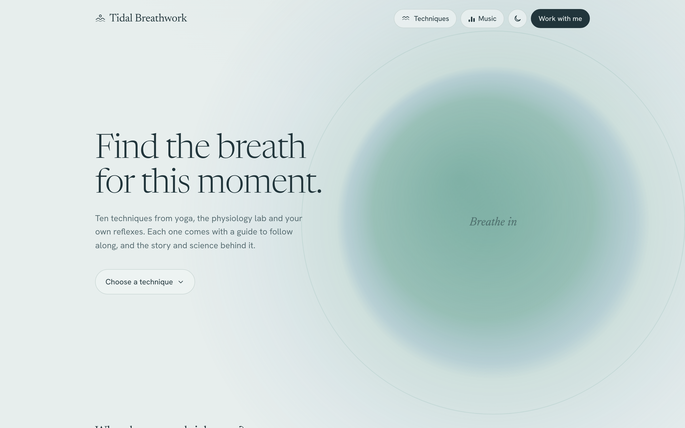

# Tidal Breathwork

Find the breath for this moment: ten guided breathing techniques, with a voice guide to follow along and the story and science behind each one.

**[See it live at breathwork.nicolelin.com →](https://breathwork.nicolelin.com)**

## What it does

Tidal Breathwork gathers ten techniques from yoga, the physiology lab and your own reflexes, from box breathing and the physiological sigh to alternate nostril breathing and breath of joy, and lets you filter them by what you need right now. Each technique has its own animated guide that paces every inhale, hold and exhale, with my recorded voice, an optional breath tone and chimes, and background music or binaural beats synthesised live in the browser. Every page also covers how to practise, where the technique comes from, what the research says, and when to take care.

## Built with

Vanilla JavaScript, the Canvas 2D API and the Web Audio API in a single HTML file, plus the recorded voice clips in `audio/`. No framework, no build step, no runtime dependencies. Google Fonts is the only external request.

To regenerate the social image, icons and screenshot: `npm install`, `npx playwright install chromium`, then `npm run og`. Playwright is only used by this script; nothing in it ships with the site.

## Run it locally

Download the repo and serve the folder over HTTP, for example with `python3 -m http.server`, then open http://localhost:8000. The voice clips are loaded with `fetch`, so opening `index.html` straight from disk works but without the recorded voice.

## Accessibility

Controls are real buttons, links and inputs with labels and states, and everything works from the keyboard: Space pauses a session and Escape closes it. Phase changes and filter results are announced through live regions, and the page behind a session is made inert while it's open. The page respects `prefers-reduced-motion` and adapts to light and dark mode.

---

Made by [Nicole Lin](https://nicolelin.com).
